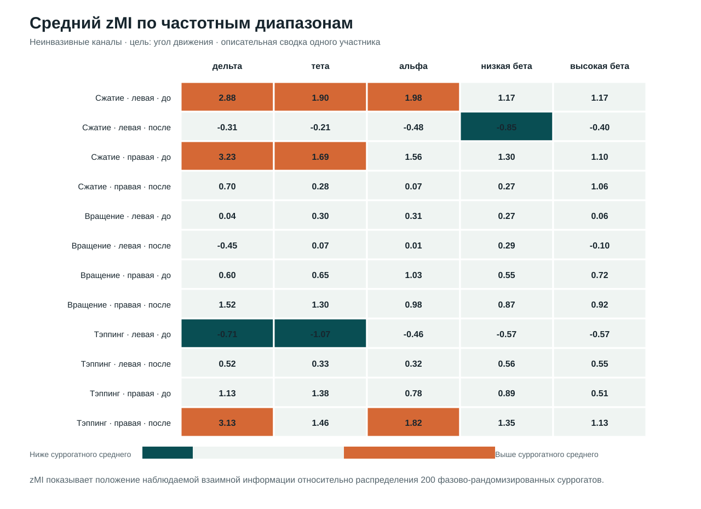
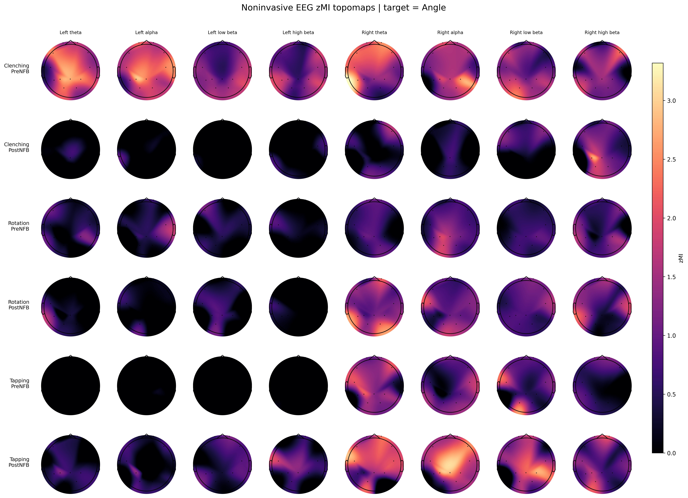

# Neural-signal and movement-kinematics analysis

This repository contains a Python pipeline for exploring statistical dependence between movement kinematics and the amplitude envelopes of frequency-filtered neurophysiological signals. Observed mutual information (MI) is standardized against phase-randomized surrogate kinematic signals to obtain zMI.

The work was a technical pilot on a limited dataset. It demonstrates the analysis pipeline and produces descriptive results; it does not support population-level, clinical, or causal conclusions.



## Analysis workflow

1. Load synchronized neurophysiological and kinematic channels from FIF files.
2. Optionally resample the signals after checking the requested frequency range.
3. Filter neural channels in overlapping frequency bands.
4. Extract amplitude envelopes with the Hilbert transform.
5. Estimate mutual information with angle, velocity, acceleration, or an explicitly named target channel.
6. Phase-randomize the target signal to create surrogate control distributions.
7. Standardize observed MI relative to the surrogates.
8. Save parameters, logs, manifests, numerical summaries and figures separately.

The pipeline supports invasive and non-invasive channel groups, batch processing, cached plot-only runs, configurable frequency grids, and parallel execution across channels and frequency bands.

## Repository structure

```text
src/P1_mi_pipeline_refactored.py                    main computation and plotting pipeline
src/make_prepost_zmi_report_figures.py              descriptive report across conditions
src/make_invasive_movement_comparison_figures.py    invasive-channel comparison figures
docs/figures/                                       de-identified example visualizations
requirements.txt                                    direct Python dependencies
```

Raw FIF files, derived numerical results and participant-level metadata are intentionally excluded.

## Input assumptions

The main pipeline expects FIF files containing synchronized neural channels and one or more kinematic channels. The built-in aliases recognize `Angle`, `Velocity`, `Acceleration`, `MoCap_Ang`, `MoCap_Vel` and `MoCap_Acc`. Channel-group definitions are listed near the beginning of the main script and should match the acquisition montage.

The reporting scripts parse run metadata from the folder naming convention created by the main pipeline. Their defaults reflect the pilot dataset and can be overridden with command-line arguments.

## Installation

Python 3.10 or newer is recommended.

```powershell
python -m venv .venv
& .\.venv\Scripts\python.exe -m pip install -r requirements.txt
```

## Example computation

Run from the repository root, supplying a local FIF file or directory:

```powershell
& .\.venv\Scripts\python.exe src\P1_mi_pipeline_refactored.py data\recording.fif `
  --run-mode compute `
  --targets angle velocity `
  --groups both `
  --out-root outputs\MI_surrogates `
  --n-surrogates 200
```

The checked-in configuration uses relative placeholder paths. Review the channel lists, frequency limits, resampling frequency, number of parallel jobs and output policies before processing a new dataset.

## Descriptive reports

After computation, reports can be built from the generated `summary.csv` files:

```powershell
& .\.venv\Scripts\python.exe src\make_prepost_zmi_report_figures.py `
  --results-root outputs\MI_surrogates `
  --output-root outputs\zMI_report

& .\.venv\Scripts\python.exe src\make_invasive_movement_comparison_figures.py `
  --results-root outputs\MI_surrogates
```

These scripts create new timestamped report directories and do not modify the existing result folders.



## Interpretation limits

- The pilot analysed one participant and one recording day.
- zMI is a surrogate-standardized descriptive statistic, not a corrected p-value.
- No population-level inference or formal paired condition contrast was performed.
- MI with a time lag, SPoC and predictive models were not implemented.

## License

The source code is released under the [MIT License](LICENSE). No rights to the underlying neurophysiological recordings or participant-level data are granted or implied.
